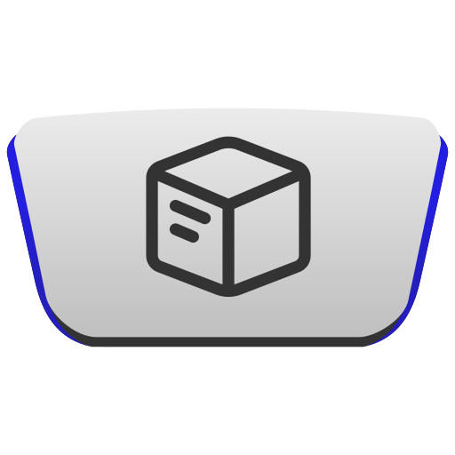
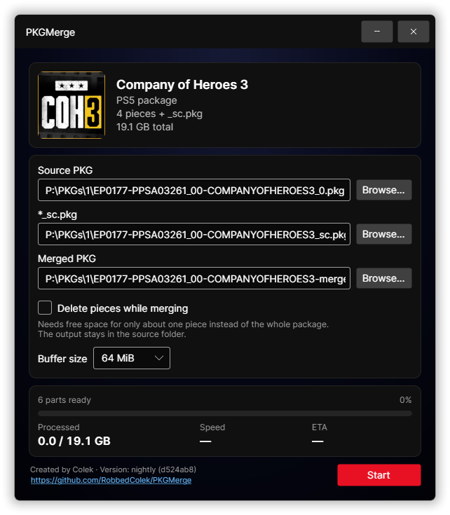

<div id="pkgmerge-logo" align="center">
    <br />
    
    <h1>PKGMerge</h1>
    <h3>Glorified replacement for <code>cat</code> and <code>copy</code></h3>
    <h3>Join split PS4 and PS5 packages into a single PKG - in a desktop app or from the command line!</h3>
    
</div>

## Features

- **PS4 and PS5** - merges split PS4 packages and split PS5 packages, including the `_sc.pkg`.
- **App and CLI** - a desktop app with drag and drop and a `PKGMergeCli` command-line tool that can merge a single package or every package in a folder.
- **Merging in place** - turns the root file into the merged package and deletes each piece as soon as it's merged, so you need free space for about one piece instead of the whole package.
- **Cross-platform** - works on Windows, Linux and macOS (Apple Silicon/Intel).

### Retail packages only

PKGMerge merges **retail** packages, the split PKGs served by PSN: games, updates and DLCs. You can get them:

- From your own entitlements, e.g. with [PSNav](https://github.com/RobbedColek/PSNav) 😉
- From [OrbisPatches](https://orbispatches.com) (PS4) or [ProsperoPatches](https://prosperopatches.com) (PS5).

Patches from OrbisPatches and ProsperoPatches are retail updates, so they **won't work on FPKG games**.

## Download
Prebuilt, self-contained single-file builds are published on the [Releases](https://github.com/RobbedColek/PKGMerge/releases) page. No installation or .NET runtime is needed.

| Platform | App | CLI |
|---|---|---|
| Windows (x64) | `PKGMerge-win-x64.zip` | `PKGMergeCli-win-x64.zip` |
| Linux (x64) | `PKGMerge-linux-x64.tar.gz` | `PKGMergeCli-linux-x64.tar.gz` |
| macOS (Apple Silicon) | `PKGMerge-osx-arm64.tar.gz` | `PKGMergeCli-osx-arm64.tar.gz` |
| macOS (Intel) | `PKGMerge-osx-x64.tar.gz` | `PKGMergeCli-osx-x64.tar.gz` |

Extract the archive and run `PKGMerge` or `PKGMergeCli`.

The nightly build is regenerated automatically from the latest commit and may be unstable.

## Usage

### App

1. Run `PKGMerge`.
2. Drop the root `<ID>_0.pkg` file (or a PS5 `<ID>.pkg` that isn't split) on the window, or click `Browse…` next to `Source PKG`.
3. The package card shows the game's name and icon, the platform, the number of pieces and the total size. Problems found in the files are listed below the progress bar.
    - Errors (red) must be fixed before you can start, e.g. a missing piece or a missing `_sc.pkg` file.
    - Warnings (yellow) are worth a look, e.g. an `_sc.pkg` file that was picked because it's the only one in the folder.
4. For a PS5 package, check the `*_sc.pkg` field and choose the file yourself if needed.
5. Click `Start`. You can `Cancel` at any time and closing the window during a merge asks before stopping it.

### Command line

#### Arguments

```
PKGMergeCli <root_0.pkg | directory> [-o|--output <path>] [--sc <file_sc.pkg>] [-y|--overwrite]
                                     [--in-place] [--buffer-size <MiB>]
```

| Argument | Description |
|---|---|
| `<root_0.pkg>` | Merge one package, starting from its root file. |
| `<directory>` | Merge every split package in the folder. |
| `-o`, `--output` | Output file, or output folder for a directory. Default: `<ID>-merged.pkg` next to the source. |
| `--sc` | PS5 only: the `_sc.pkg` file to use. |
| `-y`, `--overwrite` | Replace existing files without asking. |
| `--in-place` | Delete the pieces while merging. |
| `--buffer-size` | Buffer size in MiB, `1`-`256`. Default: `64`. |
| `-h`, `--help` | Show the usage. |

#### Exit codes

| Code | Meaning |
|---|---|
| `0` | Every package was merged. |
| `1` | Bad arguments or nothing to merge (no split packages found, invalid root file). |
| `2` | At least one package failed or was skipped, or the merge was cancelled. |

#### Examples

```bash
# Merge one package into CUSA00000-merged.pkg next to it
PKGMergeCli "D:/Downloads/UP1001-CUSA03980_00-BIOSHOCKCOMPLETE-A0102-V0100_0.pkg"

# Merge a PS5 package with an _sc.pkg file that has a different name, into game-merged.pkg
PKGMergeCli "D:/Downloads/JP0367-PPSA11079_00-3630723653971843_0.pkg" --sc "D:/Downloads/EP3036-PPSA13737_00-0492129687439402_sc.pkg"

# Merge a PS5 package that isn't split with its _sc.pkg file
PKGMergeCli "D:/Downloads/UP6312-PPSA23943_00-6310269941751438.pkg"

# Merge every package in a folder and write the results to another drive
PKGMergeCli "D:/Downloads" -o "E:/Merged" -y

# Merge without needing space for a full copy, deleting the pieces as they're merged
PKGMergeCli "D:/Downloads/EP0177-PPSA03261_00-COMPANYOFHEROES3_0.pkg" --in-place
```

## Building from source

Requires the [.NET 10 SDK](https://dotnet.microsoft.com/download).

The app's UI comes from the ColekUI git submodule, so clone with `--recursive` before building.

```bash
git clone --recursive https://github.com/RobbedColek/PKGMerge.git
git submodule update --init    # if you cloned without --recursive
dotnet run --project src/PKGMerge/PKGMerge.csproj
```

The solution has three projects:

| Project | What it is |
|---|---|
| `src/PKGMerge.Core` | The scanning and merging library, shared by the app and the CLI. |
| `src/PKGMerge` | The desktop app, built with [Avalonia](https://avaloniaui.net/) and ColekUI. |
| `src/PKGMerge.Cli` | The `PKGMergeCli` command-line tool. |

To produce a single-file build of the app for your platform:

```bash
dotnet publish src/PKGMerge/PKGMerge.csproj -c Release -r win-x64 -o publish
```

To produce a native build of the CLI:

```bash
dotnet publish src/PKGMerge.Cli/PKGMerge.Cli.csproj -c Release -r win-x64 -o publish
```

Replace `win-x64` with `linux-x64`, `osx-arm64` or `osx-x64` as needed.

## Credits

PKGMerge wouldn't exist without [pkg-merge](https://github.com/Tustin/pkg-merge) by [Tustin](https://github.com/Tustin).

This project started from that work and its conventions. Many thanks to Tustin for creating it.

## Disclaimer

PKGMerge is an unofficial tool and is not affiliated with or endorsed by Sony Interactive Entertainment.

"PlayStation", "PS4" and "PS5" are trademarks of their respective owners.

Use it only with content you own, and at your own risk.

## License

Released under the [GNU General Public License v3.0](LICENSE).
